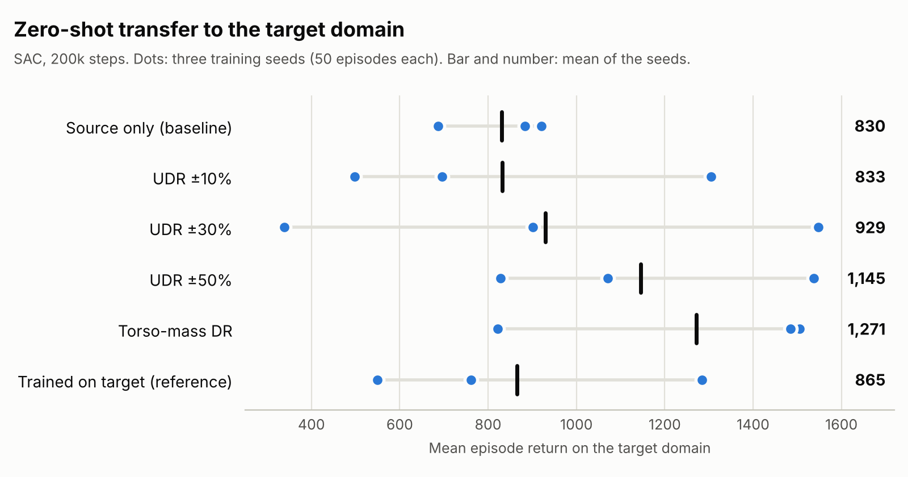

# Robust Reinforcement Learning for Sim-to-Sim Transfer in MuJoCo Hopper

[](https://github.com/Erfan-Afshinnia/robust-rl-hopper-domain-randomization/actions/workflows/tests.yml)


Can a robot controller trained in one simulator still work when the physics change? This project trains locomotion policies for the MuJoCo **Hopper** in a *source* simulation and tests them, without any fine-tuning, in a *target* simulation whose torso is 43% heavier. It then measures how much **domain randomization** reduces the performance lost in that transfer.

**Highlights**

- **Environment engineering:** ported a legacy `mujoco-py` / Gym environment to **Gymnasium** and the official **MuJoCo** bindings, with 18 registered variants for source/target dynamics, mass, friction and damping randomization, and reward shaping.
- **From-scratch RL in PyTorch:** REINFORCE (with and without a baseline) and Actor-Critic, using a tanh-squashed Gaussian policy that keeps actions inside the actuator limits.
- **Controlled experiments at scale:** 30 SAC training runs (200,000 steps each, three seeds per condition) and 3,000 evaluation episodes, comparing randomization widths, a torso-mass randomization ablation, reward shaping and SAC hyperparameters.
- **Reproducible by design:** one command per study, per-episode CSVs for every result, 36 unit tests in CI, and seeded runs that reproduce earlier models exactly.

## Results

<picture>
  <source media="(prefers-color-scheme: dark)" srcset="assets/target_return_dark.png">
  
</picture>

All policies use SAC (Stable-Baselines3, default hyperparameters, 200,000 steps) with training seeds 42, 7 and 123. Each policy is evaluated for 50 deterministic episodes. Values are the mean of the three seed means ± the standard deviation across seeds.

| Training condition | Source return | Target return | Target return per seed (42 / 7 / 123) |
|---|---:|---:|---|
| Source only (baseline) | 1088.0 ± 270.8 | 830.5 ± 126.0 | 686.6 / 921.2 / 883.6 |
| UDR ±10% | 1047.1 ± 501.5 | 832.6 ± 420.6 | 1304.6 / 695.8 / 497.5 |
| UDR ±30% | 1015.7 ± 600.6 | 929.3 ± 605.1 | 901.4 / 1547.9 / 338.6 |
| **UDR ±50%** | **1446.5 ± 29.7** | 1145.2 ± 360.5 | 827.6 / 1537.0 / 1071.0 |
| Torso-mass DR | 1460.4 ± 49.4 | **1271.1 ± 388.7** | 1485.2 / 822.4 / 1505.7 |
| Height/posture reward | 801.7 ± 166.8 | 865.0 ± 343.4 | 1239.5 / 565.0 / 790.6 |
| Torso-mass DR + height/posture reward | 1118.9 ± 207.0 | 1104.0 ± 428.8 | 1496.3 / 1169.5 / 646.2 |
| Trained on target (reference) | 892.3 ± 334.5 | 865.4 ± 378.3 | 1284.8 / 549.7 / 761.7 |

**What the results show**

- **Wider randomization transferred more reliably.** Uniform domain randomization (UDR) of the thigh, leg and foot masses by ±50% beat source-only training on the target for all three seeds, and it was the most stable condition on the source. ±30% did so for two seeds, and ±10% for one.
- **Randomizing the shifted parameter was not clearly necessary.** Torso-mass randomization had the highest mean target return, but only two of three seeds transferred well. Wide UDR, which never changes the torso, came close.
- **Reward shaping did not help.** A height/posture penalty lowered source return in both ablation pairs, and combined with torso-mass randomization it also lowered target return.
- **Seed variance is a real effect at this budget.** Even policies trained directly on the target varied from 550 to 1285 across seeds. With three seeds, none of the differences above is statistically established.

**SAC hyperparameters.** Two variants were tuned on the source domain only, as the target would not be available in a real deployment. A learning rate of 1e-4 was worse than the default for every seed (722.6 vs 1088.0 source return). Delaying learning by 10,000 random steps, the RL Baselines3 Zoo setting for Hopper, tied with the default on average (1097.0) but was much less stable across seeds. For two seeds it raised source return to about 1450, yet target return stayed near 800–820: a better fit to the source did not transfer. Results: [`results/hparam_study/`](results/hparam_study/).

**Other algorithms.** PPO (seed 42) reached 1466.5 on source and 1524.5 on target. The from-scratch methods (1,000 training episodes, seeds 42 and 7) reached about 110–220 and never completed a full 500-step episode:

| Algorithm | Seed 42: source / target | Seed 7: source / target | Training time (s), seed 42 / 7 |
|---|---|---|---|
| REINFORCE | 210.5 / 211.3 | 173.2 / 171.0 | 115.2 / 137.7 |
| REINFORCE, baseline b = 20 | 176.0 / 181.3 | 208.2 / 206.3 | 187.6 / 258.0 |
| REINFORCE, baseline b = 84.89 | 222.0 / 222.9 | 155.4 / 157.8 | 139.3 / 131.4 |
| Actor-Critic | 172.4 / 185.7 | 111.0 / 111.5 | 98.9 / 90.7 |

## Problem Setup

| | Torso | Thigh | Leg | Foot |
|---|---:|---:|---:|---:|
| Source mass (kg) | 2.566 | 4.058 | 2.781 | 5.316 |
| Target mass (kg) | 3.665 | 4.058 | 2.781 | 5.316 |

The only difference between the domains is the torso mass: the source torso weighs 70% of the target torso. The target plays the role of the "real world". Policies observe 11 values (torso height and angle, three joint angles, and six velocities), output three continuous torques in [-1, 1], and are rewarded for forward progress, staying alive and low control effort. Episodes end when the hopper falls or after 500 steps.

**Domain randomization conditions**

- **UDR ±10/30/50%:** at every reset, the thigh, leg and foot masses are sampled uniformly around their source values. The torso stays at its source mass.
- **Torso-mass DR:** the torso mass is sampled uniformly between 0.5× and 1.5× its source value. The range is set from the source mass alone, but it contains the target mass (1.43× source), and the condition assumes it is known that the torso is the uncertain parameter.
- **Height/posture reward:** the standard reward minus quadratic penalties on torso height error and torso angle. All evaluations use the standard reward.

## Quickstart

Developed with Python 3.11 on Windows; the test suite also runs on Ubuntu in CI.

```bash
python -m venv .venv
# Windows: .venv\Scripts\activate    macOS/Linux: source .venv/bin/activate
python -m pip install -r requirements-dev.txt
python -m pytest tests -q
```

Train and evaluate one SAC policy (about one hour on a laptop CPU):

```bash
python train_sb3.py --algo sac --train-env CustomHopper-source-v0 --test-env CustomHopper-target-v0 --total-timesteps 200000 --seed 42
python evaluate_sb3.py --model sac_hopper_source.zip --algo sac --envs CustomHopper-source-v0 CustomHopper-target-v0 --episodes 50 --seed 1000
```

## Reproducing the Results

**SAC studies.** `run_study.py` trains every condition of a study for one seed and evaluates each model for 50 episodes on the source and target domains. Interrupted runs resume where they stopped.

```bash
python run_study.py --study udr --seed 42        # UDR widths and the target-trained reference
python run_study.py --study ablation --seed 42   # source baseline, torso-mass DR, reward shaping
python run_study.py --study hparam --seed 42     # SAC hyperparameter variants
```

Repeat with `--seed 7` and `--seed 123` (one terminal per seed runs them in parallel), then aggregate and redraw the figure:

```bash
python aggregate_seeds.py --eval-dir results/udr_study/eval --output-dir results/udr_study
python plot_results.py
```

**From-scratch methods.**

```bash
python train.py --algo reinforce --n-episodes 1000 --seed 42 --model-path results/policy_gradient/models/reinforce_s42.mdl --log-csv results/policy_gradient/training/reinforce_s42.csv
python train.py --algo reinforce --baseline 20 --n-episodes 1000 --seed 42 --model-path results/policy_gradient/models/reinforce_b20_s42.mdl
python train.py --algo actor_critic --n-episodes 1000 --seed 42 --model-path results/policy_gradient/models/actor_critic_s42.mdl
python evaluate_policy.py --model results/policy_gradient/models/reinforce_s42.mdl --env CustomHopper-target-v0 --episodes 50 --seed 42 --output-csv results/policy_gradient/eval/reinforce_s42__CustomHopper-target-v0__eval50.csv
```

Trained SAC models (about 3 MB each) are not stored in the repository. Every reported number can be regenerated with the commands above.

## Repository Structure

```text
├── env/
│   ├── custom_hopper.py      # Source/target domains, randomization, reward variants
│   ├── mujoco_env.py         # Gymnasium base class for MuJoCo environments
│   └── assets/hopper.xml
├── agent.py                  # Gaussian policy, value network, REINFORCE / Actor-Critic updates
├── train.py                  # Train REINFORCE or Actor-Critic
├── evaluate_policy.py        # Evaluate a REINFORCE / Actor-Critic policy
├── train_sb3.py              # Train PPO or SAC (Stable-Baselines3)
├── evaluate_sb3.py           # Evaluate saved PPO / SAC models to per-episode CSVs
├── run_study.py              # Multi-condition SAC studies for one seed
├── aggregate_seeds.py        # Aggregate evaluation CSVs across seeds
├── plot_results.py           # Draw the results figure
├── random_policy.py          # Random-policy sanity check (add --render to watch)
├── results/
│   ├── udr_study/            # UDR widths and target-trained reference
│   ├── ablation/             # Source baseline, torso-mass DR, reward shaping
│   ├── hparam_study/         # SAC hyperparameter variants
│   ├── ppo/                  # PPO evaluation
│   └── policy_gradient/      # REINFORCE / Actor-Critic logs, models and evaluations
├── tests/                    # Environment and algorithm unit tests
└── assets/                   # README figures
```

Each results folder contains per-episode CSVs (`eval/`), per-seed results (`per_seed.csv`) and across-seed summaries (`summary.csv`).

## Limitations and Next Steps

- This is sim-to-sim transfer with one known source of mismatch, not a sim-to-real result.
- Three seeds per condition are too few for reliable rankings, given the large variation between seeds.
- SAC was trained for 200,000 steps, a fifth of the 1,000,000 used by the RL Baselines3 Zoo for Hopper. Longer training is the most likely way to reduce the seed variance.
- Friction, damping and combined randomization are implemented (`CustomHopper-frictiondr-v0`, `-dampingdr-v0`, `-extdr-v0`) but not yet evaluated. Adaptive methods that learn the randomization range are a natural next step.

## Acknowledgements

The initial Hopper source/target environment scaffold was adapted from [lambdavi/rl_mldl_25](https://github.com/lambdavi/rl_mldl_25). The Hopper model and the MuJoCo environment wrapper derive from [OpenAI Gym](https://github.com/openai/gym) (MIT License). Built with [Gymnasium](https://gymnasium.farama.org/), [MuJoCo](https://mujoco.org/), [PyTorch](https://pytorch.org/) and [Stable-Baselines3](https://stable-baselines3.readthedocs.io/).

## License

[MIT](LICENSE) © Erfan Afshinnia
